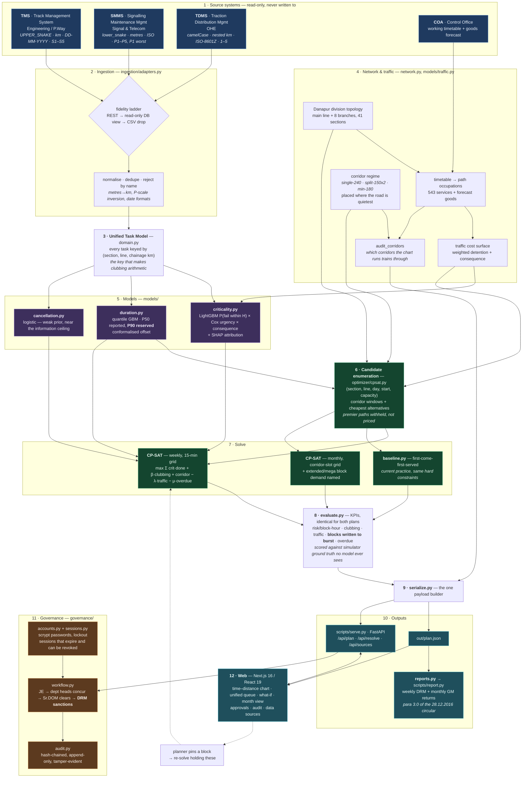
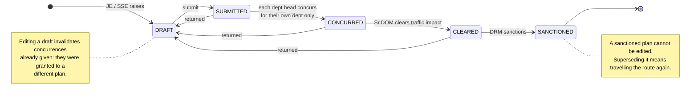
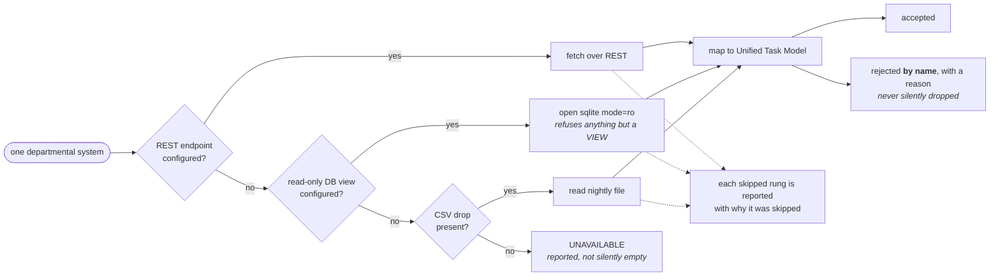

# TRACKSEN — architecture

Three diagrams. The first is the whole system; the other two are the subsystems that do not
fit cleanly inside a data-flow picture because they are about *authority* and *degradation*
rather than about data moving.

Read [README.md](../README.md) for what each module does and
[AUDIT.md](AUDIT.md) for which parts of this are load-bearing and which are stand-ins.

---

## 1. The whole system

Everything flows one way: three departmental systems are read, never written; their records
become one task model keyed by chainage; models score that model; the solver places blocks
into windows priced against real train paths; and the plan comes out the far end as a
recommendation that a person still has to sanction.

**Three things in that picture are the whole argument.**

*The chainage key at stage 3.* Once an S&T fault at km 412 and an OHE job at km 412.6 are
written in the same coordinates, "are these near each other" becomes arithmetic, and
clubbing becomes something a solver can find.

*The arrow from `duration.py` into candidate enumeration, not just into the objective.* A
task whose P90 plus its withdrawal overruns the corridor is never offered to the solver as
though it fitted. It is named as needing an extended block instead.

*The dotted line back from the web.* A planner drags a block, says "keep that where I put
it and redo the rest", and the solver takes the placement as a hard fact. That is a
different question from the one the original solve answered, and it is the one a human
actually asks.

---

## 2. The approval route

TRACKSEN produces a plan. It never grants a block. `governance/workflow.py` is where that
stops being a sentence in a README and becomes a rule the code enforces — each transition
appended to a hash-chained log, and refused attempts recorded too.

Only the DRM may sanction; every other role gets a `403`. A department head concurs for
their own department and no other. Sanction requires every department present to have
concurred *and* operations to have cleared — skipping the order gives a `409` listing what
is outstanding. Four rules, all enforced, all tested, and all re-applied as mutants in
`scripts/mutation_check.py` to confirm a test goes red for each.

---

## 3. The ingestion fallback ladder

A design that presumes an API cannot be commissioned. Parts of the estate will give you
nothing but a nightly file, so each source is tried in descending order of fidelity and
falls back — and the run log says which mode answered and why the better ones were skipped.

**Two rules the layer is built on.** Nothing is ever written to a source system — the
SQLite adapter opens `mode=ro` and refuses to run against anything but a view, because a
DBA grants a view rather than a table and the code should make the weaker grant sufficient.
And a record that cannot be mapped is rejected by name, with a reason: silently dropping
malformed rows is how a division discovers six months later that its worst defects were
never scheduled because a date format changed.

The two failures worth testing for here are the ones that *don't* throw. SMMS publishes
chainage in metres — read it as kilometres and every signalling job lands a thousand times
further down the road. SMMS priority P1 is the *most* urgent, the reverse of TMS severity —
map both straight onto an integer and the plan attends the least urgent faults first.
Neither raises an exception. Both are covered by tests and by the mutation check.
